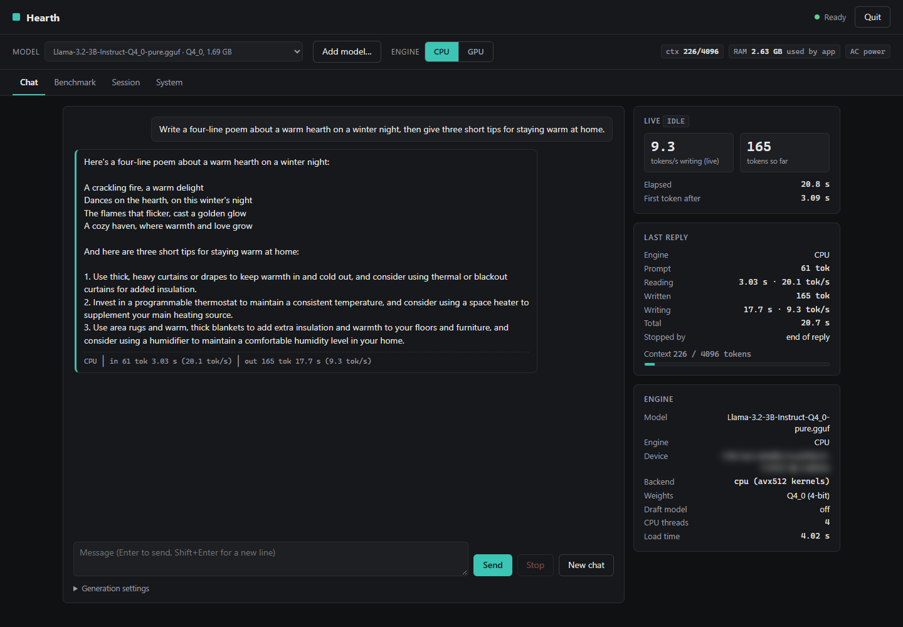
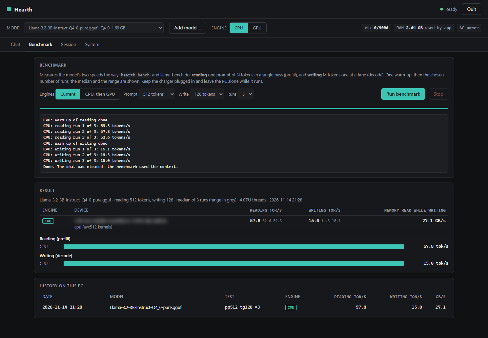
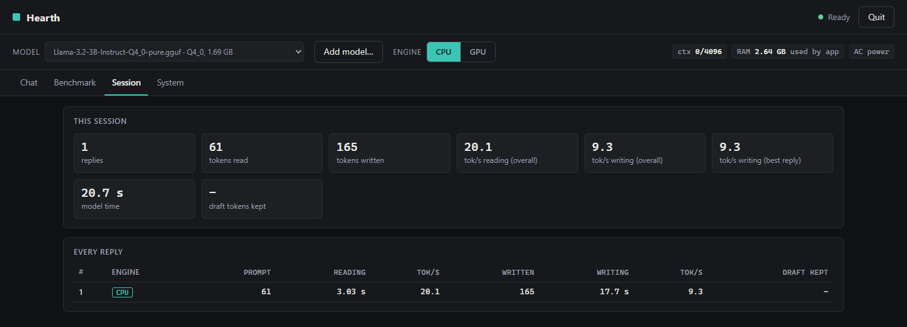
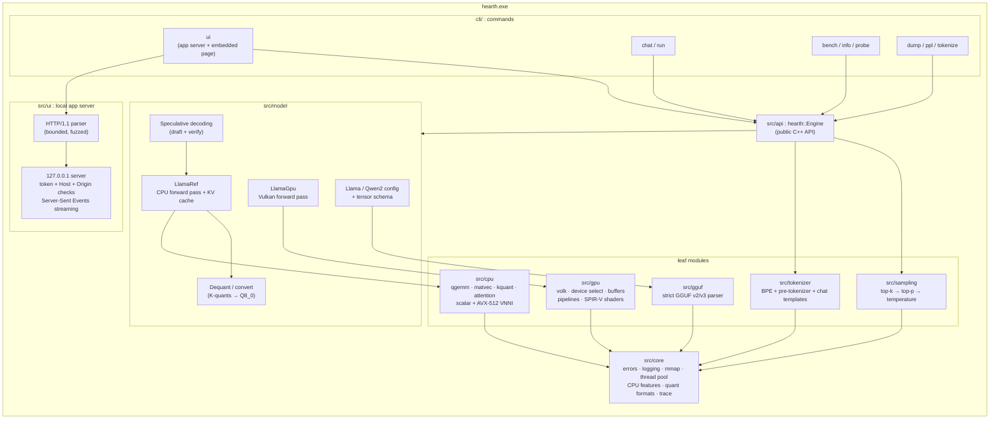
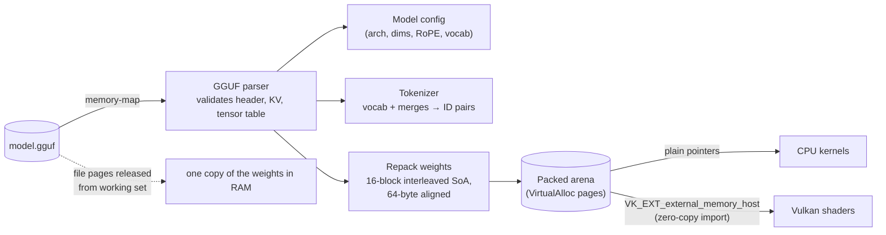
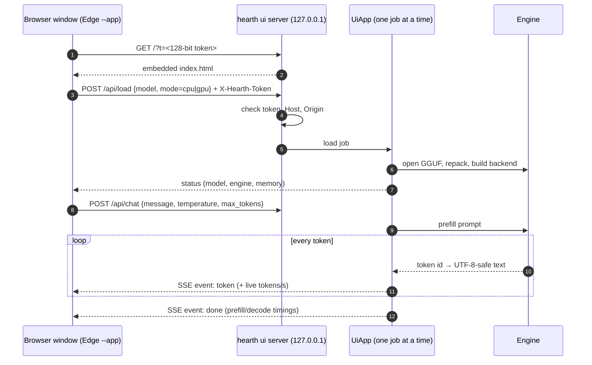
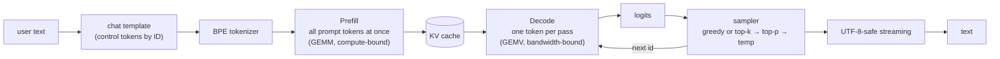
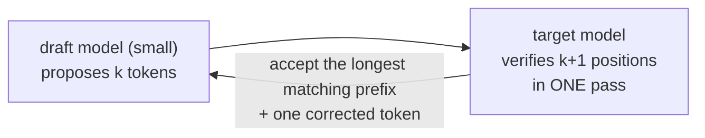

# Hearth

**A from-scratch LLM inference engine in modern C++20, with a local desktop app.**

Hearth loads quantized GGUF models (Llama 3 / 3.2 and Qwen2.5) and runs them with
its own GGUF parser, tokenizer, forward pass, SIMD kernels, Vulkan compute shaders,
sampler, and HTTP app server. It doesn't wrap llama.cpp or any other inference
runtime. llama.cpp is used only as an external **correctness oracle** in the test
suite.


<p align="center">
  
</p>

---

## Contents
- [Highlights](#highlights)
- [Download and run](#download-and-run)
- [Screenshots](#screenshots)
- [Architecture](#architecture)
- [How a token is generated](#how-a-token-is-generated)
- [Engineering decisions](#engineering-decisions)
- [Supported models](#supported-models)
- [Command-line usage](#command-line-usage)
- [Building from source](#building-from-source)
- [Testing and verification](#testing-and-verification)
- [Repository layout](#repository-layout)
- [Security model](#security-model)
- [License](#license)

---

## Highlights

| Area | What Hearth does |
|------|------------------|
| **Single executable** | One self-contained `hearth.exe` (about 1.7 MB): a static C++ runtime, embedded SPIR-V shaders, and the web UI compiled in. It imports only Windows system DLLs. |
| **Own GGUF loader** | A strict GGUF v2/v3 parser that treats model files as untrusted input: every offset, size and count is bounds- and overflow-checked, and the parser is fuzzed with libFuzzer under ASan. |
| **Own tokenizer** | Llama-3 and Qwen2 byte-level BPE with a hand-written pre-tokenizer and generated Unicode 15.1 tables. Token IDs match `llama-tokenize` on an adversarial corpus. User text can never forge control tokens. |
| **Fast CPU backend** | Q8_0 / Q4_0 / Q4_K / Q6_K kernels for **AVX-512 VNNI**, with a scalar fallback chosen at run time, plus a pinned persistent thread pool. Results are **bit-identical** across ISAs and thread counts. |
| **Vulkan GPU backend** | The whole forward pass in GLSL compute shaders. It reads the CPU's weight pages through `VK_EXT_external_memory_host` (zero-copy, one copy of the weights in RAM). If the GPU fails, it falls back to the CPU. |
| **Speculative decoding** | A small draft model proposes tokens, and the target model verifies them all in one batched pass. Greedy output is provably unchanged. The draft length adapts to measured costs. |
| **Broad quantization support** | Runs Q8_0, Q4_0, Q4_K_M, F16, BF16 and F32 natively. Q4_1, Q5_0, Q5_1, Q2_K, Q3_K and Q5_K are decoded bit-for-bit as ggml does and converted to Q8_0 at load. |
| **Desktop app** | `hearth ui`: chat with streaming tokens, live tokens/s, a llama-bench-style benchmark, a per-session report and system info, served from 127.0.0.1 with a per-launch secret token. |
| **Observability** | `--trace` writes a Chrome/Perfetto trace of every matmul, attention, norm and RoPE. `hearth probe` measures memory bandwidth, latency and compute ceilings. |

---

## Download and run

1. Download `hearth-2.0.0-win-x64.zip` from the [**Releases**](../../releases) page and unzip it.
2. Get a GGUF model, for example `Llama-3.2-1B-Instruct-Q8_0.gguf` or `Llama-3.2-3B-Instruct-Q4_0.gguf` from Hugging Face.
3. Put the model in a `models\` folder next to `hearth.exe`, or add it from the app with **Add model…**.
4. Double-click **`hearth.exe`**. The app opens in its own window.

**Requirements:** Windows 10/11 x64. AVX-512 VNNI is used when available, and every x86-64 CPU runs the scalar path. A Vulkan 1.3 GPU is optional.

Prefer the terminal?

```powershell
hearth chat --model models\Llama-3.2-3B-Instruct-Q4_0.gguf
hearth run  --model models\Llama-3.2-1B-Instruct-Q8_0.gguf --chat --prompt "Explain RoPE in two sentences."
```

---

## Screenshots

| Chat with live metrics | Benchmark (prefill / decode, median of N runs) |
|---|---|
|  |  |

**Session report:** every reply's prompt size, prefill and decode speed, and time.



---

## Architecture

### Component view

Dependencies point one way: `cli → api → model → {gguf, tokenizer, cpu, gpu} → core`.
Nothing in `core` knows about models, and nothing in `gpu` knows about Llama.



### Model loading and memory layout



When the model loads, Q8_0 / Q4_0 tensors are **repacked** into a structure-of-arrays layout. The fp16 scales of each group of 16 blocks sit in one array, and the quants are interleaved so that one SIMD register holds one block per lane. After a tensor is repacked, its file pages are released from the working set, so the process holds a single copy of the weights. The GPU imports the same pages instead of copying them.

### The app: request flow



---

## How a token is generated



Each transformer layer runs RMSNorm, Q/K/V projections (plus biases for Qwen2), RoPE (normal or NEOX), grouped-query attention over the KV cache, an output projection, RMSNorm, and a SwiGLU feed-forward block. All of this is in `src/model/llama_ref.cpp` (CPU) and `src/model/llama_gpu.cpp` plus `src/gpu/shaders/*.comp` (GPU).

**Prefill** is matrix × matrix work and is compute-bound. Hearth uses blocked int8 GEMM kernels there. **Decode** reads every weight once per token, so its ceiling is roughly memory bandwidth ÷ model size. Its kernels are tuned to stream rows in order and hand out rows to threads dynamically.

### Speculative decoding



Verifying k proposals costs about the same as one decode step, because the weights are read once for all of them. The draft length is chosen from measured per-pass costs. In greedy mode the output is bit-identical to plain decoding. With sampling, the output has the same distribution as plain decoding.

---

## Engineering decisions

- **One canonical FP32 summation order for every quantized dot product.** Hearth uses 16 lanes, no FMA contraction, and a fixed halving tree. Because of this, the scalar kernel, the AVX-512 kernel, every thread count and the GPU shaders produce the **same bits**, which the tests check directly. The GPU shaders carry the SPIR-V `NoContraction` decoration throughout, and a build check enforces it.
- **ggml-identical activation quantization.** Hidden states are quantized to int8 exactly as ggml does it. This lets Hearth be compared layer by layer against llama.cpp.
- **Each output element has exactly one owner thread.** Results are deterministic at any thread count. Rows go out in 4-row tiles, and attention tasks are dealt round-robin, because later tokens attend to more positions.
- **Errors are typed exceptions** (`hearth::Error` + `ErrorKind`). Each kind maps to a distinct CLI exit code. Hot loops never throw, because their inputs are validated first. `HEARTH_CHECK` invariants stay on in Release builds.
- **GPU robustness.** Every Vulkan wait has a finite timeout longer than the Windows TDR, so a hang surfaces as `kDeviceLost` instead of an endless wait. Long prompts are split into submissions that stay under the TDR, and `run`, `chat` and the app continue on the CPU with a clear message.
- **Reproducible toolchain.** Third-party sources (volk, Vulkan-Headers, glslang, doctest, the Unicode Character Database) are pinned by version and SHA-256 in `scripts/pins.psd1` and built from source. No SDK installers are needed.
- **Static MSVC runtime.** The packaged executable needs no Visual C++ redistributable.

---

## Supported models

| Family | Architectures | Chat templates |
|--------|---------------|----------------|
| Llama 3 / 3.1 / 3.2 | `llama` | Llama 3.0, Llama 3.1+ (with date/system header) |
| Qwen2 / Qwen2.5 | `qwen2` (Q/K/V biases, NEOX RoPE) | ChatML |

| Number format | CPU | GPU |
|---------------|-----|-----|
| Q8_0, Q4_0 | native kernels | native shaders |
| Q4_K_M (Q4_K + Q6_K) | native kernels | – |
| Q4_1, Q5_0, Q5_1, Q2_K, Q3_K, Q5_K | converted to Q8_0 at load | converted to Q8_0 at load |
| F32, F16, BF16 | reference path | – |

The app inspects every file's header and labels it *ready*, *CPU only* or *not supported*, with a plain-language reason.

---

## Command-line usage

```text
hearth <command> [options]

  ui       the app in its own window: chat, live metrics, benchmarks
           [--port N] [--threads N] [--ctx N] [--no-browser] [--no-draft]
  chat     a conversation in the terminal: --model F [--system S]; /reset, /exit
  run      generate from one prompt: --model F (--prompt T | --file F) [--n-predict N] [--chat]
  bench    prefill and decode speed, llama-bench style: --model F [--prompt 512] [--gen 128] [--reps 5]
  info     this PC's CPU, GPU and memory; or a model file: --model F [--tensors] [--json]

developer tools
  dump     run a backend on token IDs and write named tensors (layer-by-layer diffing)
  ppl      perplexity with llama-perplexity's protocol
  tokenize text → token IDs, like llama-tokenize
  probe    memory bandwidth, latency and compute ceilings

common options
  --backend cpu|gpu|cpu-ref   --threads N   --ctx N   --draft F
  --temp T  --top-k K  --top-p P  --seed N
  --isa auto|scalar|avx512    --log-level LEVEL   --trace out.json
```

Examples:

```powershell
# Benchmark prefill (512 tokens) and decode (128 tokens), 5 repetitions
hearth bench --model models\Llama-3.2-1B-Instruct-Q8_0.gguf --reps 5

# Speculative decoding with a 1B draft for a 3B target
hearth chat --model models\Llama-3.2-3B-Instruct-Q8_0.gguf --draft models\Llama-3.2-1B-Instruct-Q4_0.gguf

# Profile one generation in Perfetto (https://ui.perfetto.dev)
hearth run --model models\Llama-3.2-1B-Instruct-Q8_0.gguf --prompt "Hello" --trace trace.json
```

---

## Building from source

**Prerequisites** (all free):
- Windows 10/11 x64
- Visual Studio 2022 Build Tools with the *Desktop development with C++* workload
- CMake ≥ 3.28 and [Ninja](https://ninja-build.org/) on `PATH`, or set `HEARTH_NINJA`
- PowerShell 7 (`pwsh`)
- Python 3.12 (only for the verification tools)

```powershell
git clone https://github.com/sohammahajan6/Hearth-Inference-Engine.git
cd Hearth-Inference-Engine

pwsh -File scripts\setup.ps1                  # fetch pinned deps, build glslang, create .venv
pwsh -File scripts\build.ps1 -Preset release  # → build\release\cli\hearth.exe
pwsh -File scripts\test.ps1  -Tier quick      # unit + kernel tests
pwsh -File scripts\package.ps1                # → build\package\hearth-<version>-win-x64.zip
```

Build presets: `release`, `debug`, and `asan` (clang via [llvm-mingw](https://github.com/mstorsjo/llvm-mingw), with AddressSanitizer + UBSan; set `HEARTH_LLVM_MINGW` to its `bin` folder). `build.ps1` loads the MSVC developer environment itself and refuses to build if `link.exe` resolves to anything but MSVC's linker. Git for Windows ships a different `link.exe` that would otherwise shadow it. Set `HEARTH_MSVC_TOOLSET` (for example `14.44`) to pin a specific MSVC version.

Model files for the model-tier tests can be fetched and hash-checked with `pwsh -File scripts\fetch-models.ps1` (Llama 3.2 1B set) or `-Set 3b`.

---

## Testing and verification

| Layer | What it checks |
|-------|----------------|
| **Quick tier** (~30 s, 120+ test cases, 1.6 M+ assertions, [doctest](https://github.com/doctest/doctest)) | fp16/bf16 conversion against F16C hardware; the GGUF parser on malformed inputs; every quant format against ggml's own golden hashes; scalar vs AVX-512 vs GPU kernels **bit for bit**; forward passes on tiny random models at 1/2/3/4/8 threads; pre-tokenizer rules; BPE; chat templates; the sampler; the HTTP parser; the app's API |
| **Model tier** | Loader, forward pass, tokenizer and multi-turn chat token IDs on real models, against values recorded from llama.cpp |
| **Oracle gates** (`scripts/oracle-check.ps1`, `greedy-check.ps1`, `ppl-check.ps1`, `kld-check.ps1`, `tokenizer-check.ps1`, `chat-check.ps1`) | Layer-by-layer tensor diffs against llama.cpp's own forward pass (`tools/oracle/`), greedy-generation agreement, perplexity, and KL divergence over 10k+ positions |
| **Fuzzing** (`scripts/fuzz.ps1`) | libFuzzer + ASan on the GGUF parser, the tokenizer and the HTTP request parser |
| **Sanitizers and static analysis** | All tiers under clang ASan + UBSan; MSVC `/analyze`; clang-tidy; clang-format check in a pre-commit hook |
| **End-to-end app check** (`scripts/ui-check.ps1`) | Starts the real app headless, checks that a missing token, a foreign Host or Origin, or no key is refused, then loads a model, streams a chat, runs a benchmark and quits cleanly |
| **Determinism** (`scripts/determinism.ps1`) | Identical output hashes at 1, 2, 4 and 8 threads |

---

## Repository layout

```text
.
├── cli/                 hearth.exe: argument parsing, subcommands, the app (ui_app.*, ui/index.html)
├── include/hearth/      public C++ API (hearth::Engine)
├── src/
│   ├── api/             Engine implementation
│   ├── core/            errors, logging, mmap, thread pool, CPU features, quant formats, tracing
│   ├── gguf/            strict GGUF parser and type table
│   ├── tokenizer/       BPE, pre-tokenizer, Unicode tables, chat templates
│   ├── model/           config, reference + GPU forward passes, dequant, speculative decoding
│   ├── cpu/             qgemm / matvec / kquant / attention kernels (scalar + AVX-512)
│   ├── gpu/             Vulkan context, buffers, pipelines, timestamps, shaders/*.comp
│   ├── sampling/        greedy and top-k/top-p/temperature sampling
│   ├── probe/           bandwidth/latency/compute probe
│   └── ui/              HTTP/1.1 parser and local server
├── tests/               unit, kernel, integration and fuzz targets (+ seed corpora)
├── tools/               Python verification tools and the llama.cpp oracle programs
├── scripts/             build, test, package, fetch, benchmark and verification scripts
├── cmake/               compiler options and helpers
└── assets/screenshots/  README images
```

---

## Security model

- **Model files and user text are untrusted.** The GGUF loader and the tokenizer validate everything before use, and both are fuzzed. Text typed into a chat, such as `<|eot_id|>`, stays plain text and can never become a control token.
- **No network access.** The only server is `hearth ui`, which binds to **127.0.0.1** only. Every request must carry a random 128-bit per-launch token and a matching `Host` and `Origin`. This blocks DNS rebinding and cross-site requests. The request parser has hard size limits and is fuzzed.
- **No telemetry, no accounts, no downloads at run time.**

---

## License

Hearth is licensed under the [Apache License 2.0](LICENSE).
Third-party components and their licenses are listed in [THIRD_PARTY_NOTICES.md](THIRD_PARTY_NOTICES.md).
Model weights are not included and are subject to their own licenses (for example the Llama 3.2 Community License or Apache-2.0 for Qwen2.5).
